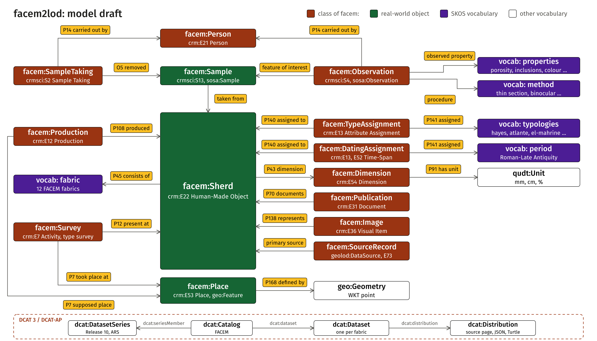

# PRIMER – facem2lod

Arbeitsplan für facem2lod: die FACEM-Datenbank (facem.at, Keramik-Fabrics) als Linked Open Data, mit Brücke zu geo-lod. Wird zu Beginn jedes Chats komplett hochgeladen und am Ende zurückgeschrieben. Teil A gilt immer, Teil B ist die Übersicht, Teil C sind die Schritte, Teil D sind offene Punkte.

---

## Teil A – Immer gültig

### A1 Ausgangslage

| Was | Wo | Rolle |
|---|---|---|
| Quelle | `https://facem.at` | Keramik-Fabrics, Release 10 (November 2026): African Red Slip Ware aus Tunesien |
| Erster Versuch | `facem_run.py`, `facem_ontology.py`, `facem_pipeline.py`, `output/` | entfernt in S6 (2026-11-10), steht in der Git-Historie (Commit 6f04b3e) |
| Skeleton | `main.py`, `py/facem_utils.py` | Orchestrator, Konstanten, kanonische Writer |
| Harvest | `py/step_harvest.py` | einziger Schritt mit Netzwerk; legt Fabric- und Probenseiten unverändert in `data/raw/html/` ab |
| Parser | `py/step_parse.py` | HTML → JSON in `data/derived/json/` (Tabs, Sektionen, Kartenpunkte, weitere Proben), Feldkatalog in `data/derived/field_catalogue.json` |
| Tests | `tests/` | Parser gegen synthetische Fixture |
| Schwesterprojekt | `GeoScience-FAIRification-LOD` (geo-lod) | gleiche Muster: CRM, CRMsci, SOSA, QUDT, GeoSPARQL, SHACL |

**Befunde** (aus dem, was tatsächlich gesehen wurde):

- 2026-11-10: Das Repo hat einen Commit (6f04b3e, 2026-03-21), ein leeres README und drei Skripte mit zusammen rund 900 Zeilen.
- 2026-11-10: `output/facem_records.json` enthält für `bnap-a-11` den Wert `tab_count: 0`, alle vier Blöcke leer. Das `facem.ttl` besteht deshalb nur aus Platzhaltern (`BNAP-A-11-sample`). Der erste Lauf hat also keine Tabellen gefunden. Ursache ungeklärt: fehlender `lxml`-Parser oder geänderte Markup-Struktur.
- 2026-11-10: facem.at wurde 2024–2026 neu gebaut (Wiener Universitäts-IT, FAIR-Ausrichtung). Auf den Seiten ist weder ein Export (JSON, CSV, API) noch eine Lizenzangabe sichtbar; der Zitiervorschlag lautet „FACEM - http://facem.at/<id>". Geprüft über die gerenderte Textdarstellung, nicht über das rohe HTML.
- 2026-11-10: Die Suchseite nennt für ARS zwölf Fabrics: `BD-ARS-1..3` (Bordj el Djerbi), `HB-ARS-1..3` (Henchir el Biar), `OU-ARS-1..2` (Oudna), `PH-ARS-1..4` (Pheradi Maius). Die Fabric-IDs folgen dem Muster `ORT-KATEGORIE-NUMMER`.
- 2026-11-10: `OU-ARS-1` zeigt (gerenderter Text) Felder wie Hayes-Typ (Hayes 99B), Chronologie als Zeitspanne (ca. 530–580 n. Chr.), Publikation (Hasenzagl 2019, Kat. Ou.023), Binokular-Werte (Porosität 7,5 %, Magerung 25 %) und Dünnschliff-Analyse (Claudio Capelli). Einen petrographischen Typ nennt die Seite nicht; das Feld kann also fehlen.
- 2026-11-10: Die Karte führt Filter über `map/?type=production` und `map/?type=discovery`. Die Fabric-Seiten verlinken keine einzelnen Kartenseiten (`map/*.php`); der erste Lauf fand 0 davon. Die Koordinaten stehen direkt in den Fabric-Seiten (siehe unten), die Kartenseiten sind also nicht nötig.
- 2026-11-10: Aus der Cloud-Sandbox ist facem.at nicht erreichbar (Proxy antwortet 403). Der Harvest läuft deshalb lokal bei dir.
- 2026-11-10 (Lauf S2, lokal): 12 Fabric-Seiten geholt (je rund 22,4–23,0 KB), 0 Fehler, alle mit Tabellen. Der Parser fand 39 verschiedene Abschnitt/Feld-Paare.
- 2026-11-10: Markup. Die vier Tabs liegen in `div#card_1` bis `card_4` (object data, fabric description, archaeometry, petrography); jede Tab-Leiste ist eine eigene Tabelle `class=tabs`. Felder stehen als Zeilen `Schlüssel | Wert`; Abschnittsüberschriften sind Zeilen mit leerer erster Zelle (und zusätzlich `h3`). Der erste Parser hat diese Überschriften fälschlich als Felder erfasst; korrigiert.
- 2026-11-10: Koordinaten. Kartenpunkte sind `<a lat=… long=… symbolsrc=…>`-Elemente, eines je Probe; rotes Symbol = Produktionsort, blaues = Fundort. In allen 12 Fabrics sind Produktions- und Fundort derselbe Ort mit denselben Koordinaten (4 Orte: Oudna / Uthina 36.6075, 10.1723; Bordj el Djerbi 36.7872, 9.85311; Henchir el Biar 36.7471, 9.86121; Sidi Khalifa / Pheradi Maius 36.2497, 10.3983). `interpretation of context` lautet in allen 12 „production“.
- 2026-11-10: Jede Fabric-Seite zeigt nur die repräsentative Probe und listet vier weitere Proben mit eigener Seite (z. B. `m-201-2` bis `m-201-5`). Die Probenseiten sind noch nicht geholt; ob sie das gleiche Markup haben, ist offen.
- 2026-11-10: Werte sind sehr einheitlich. Alle 84 Einschlussangaben (12 × 7 Typen) haben genau fünf kommagetrennte Teile: Häufigkeit, Rundung, Form, Farbe (mit `;` für mehrere), Größenbereich in mm. Chronologie hat die Form „Periode + Text“ (z. B. „Roman-Late Antiquity c. 530–580 CE“, „… second half of 5th century CE“); Objekttyp „Hayes <Nr> ( <Literatur> )“.
- 2026-11-10: Auffällige Werte, die vermutlich Eingabefehler sind (nicht korrigiert, nur festgehalten): `hb-ars-3` Chronologie „Roman-Early Imperial second half of 5th century CE“ (Periode und Datierung passen nicht zusammen); `bd-ars-3` Porosität „40%“ (alle anderen 2,5–15 %); `bd-ars-1` Magerung „20–25% %“; `hb-ars-3` Munsell „5 YR 6/6“ mit Leerzeichen, Katalognummer „Hb.0011“ (sonst dreistellig), `hb-ars-2` Publikation „, ,cat.“.
- 2026-11-10 (Lauf Probenseiten, lokal): 48 Probenseiten geholt, 0 Fehler. Sie haben dasselbe Markup wie die Fabric-Seiten, aber nur drei Tabs (kein Petrographie-Tab). Jede Probe hat eigene Objektdaten (Form, Typ, Datierung, Maße), denselben Fundort wie die Fabric, Interpretation durchgehend „production“, zwei Kartenpunkte und drei weitere Proben. Analyseautor, Methode und Publikation sind nur bei 1 von 48 Probenseiten gefüllt. Die repräsentativen Proben der Fabric-Seiten (`M 199/1`, `/6`, `/11` usw.) sind keine eigenen Seiten; die vier anderen je Fabric sind die Probenseiten.
- 2026-11-10: Typangaben sind nicht nur Hayes: `El Mahrine 19 (Mackensen 1993)`, `Atlante X, D2`, `sim. Fulford 27`, `sim. PM 61 (Ben Moussa 2007)`; Unsicherheit als `possibly Hayes 67`, `Hayes 67?`, `sim.`; Varianten wie `Hayes 61A/B4`. Formfeld auch `Lamp` und `unidentified`.
- 2026-11-10: Datierungen der Proben in vielen Formen: `c. 530–580 CE`, `4th/5th century CE`, `first third 5th century CE`, `320–mid-5th century CE`, `end of 4th–first half of 5th century CE`.
- 2026-11-10: Der Parser läuft nun gegen echtes Markup; 12 Tests, davon 5 gegen `data/raw/html/ou-ars-1.html`.

### A2 Zielbild

```
facem.at ──harvest──► data/raw/html/*.html (unverändert, mit harvest_manifest.json)
                           │
                         parse
                           ▼
              data/derived/json/*.json + field_catalogue.json
                           │   (lokal ansehen: S3)
                  Wikidata-Kandidaten (S4) · SKOS-Vokabulare (S5)
                           ▼
              Ontologie + RDF-Builder (S6) ──► dist/*.ttl (SHACL-geprüft)
                           │
                  Brücke zu geo-lod (S7) · Doku- und Figure-Seiten (S8)
```

Eigenschaften, die das Ergebnis haben muss:

1. Jede Rohdatei unter `data/raw/` ist unverändert, wie der Server sie lieferte; `harvest_manifest.json` hält URL und SHA-256.
2. `python main.py` zweimal hintereinander: `git status` bleibt beim zweiten Mal sauber.
3. Ohne Netzwerk läuft alles außer `harvest`.
4. Jedes Feld der Quelle taucht im Feldkatalog auf; was nicht modelliert wird, ist als verworfen vermerkt (S3).
5. Jede erzeugte IRI liegt unter `http://w3id.org/facem/` und hat ein `rdfs:seeAlso` auf die FACEM-Seite.

### A3 Querschnittsregeln

- Rohdaten liegen unter `data/raw/`, unverändert. Was ein Skript daraus macht, geht nach `data/derived/` oder `dist/`.
- Keine Uhr in der Ausgabe: kein `datetime.now()`, Datum nur über `RELEASE` in `py/facem_utils.py`.
- Zweimal laufen lassen, `git status` bleibt beim zweiten Mal sauber.
- Netzwerk nur im Schritt `harvest`, mit eigenem Verb, nie im Standardlauf.
- Parameter stehen im CONFIG-Block am Skriptanfang, nicht als Kommandozeilenargumente.
- Wiederverwendung heißt kopieren, nicht referenzieren; Ausnahme ist das geteilte Core-Vokabular, das per w3id-IRI importiert wird.
- Alles Nach-außen-Sichtbare (Code, Kommentare, README, Ontologie) ist British English; `PRIMER.md` ist Deutsch.
- Befehle für Windows `cmd`, je Zeile ein Befehl, zusammengehörige Befehle mit `&&` verkettet.
- Ein Thema pro Chat, ein Repo pro Chat.
- Lieferung als Patch-ZIP (Skill `patch-zip-delivery`), nur Quellen, erzeugte Dateien werden per Befehl neu gebaut.

### A4 Beschlusslage

| Frage | Beschluss | seit |
|---|---|---|
| Crawl-Umfang | die 12 ARS-Fabrics und alle ihre Proben (`FOLLOW_SAMPLE_PAGES` im CONFIG-Block von `step_harvest.py`); weitere Fabrics über `FABRIC_IDS` oder `SEARCH_URL` | 2026-11-10 |
| Rohdaten | HTML-Snapshot (`data/raw/html/`) plus geparstes JSON (`data/derived/json/`) | 2026-11-10 |
| Parser | generisch: Tabellen, Überschriften, Links, Bilder und Textzeilen komplett ins JSON, keine festen Feldnamen | 2026-11-10 |
| Namespace | eigenständig unter `w3id.org/facem/` | 2026-11-10 |
| IRI-Schema | `http://w3id.org/facem/entity/<typ>_<id>` (http, wie bei geo-lod) | Vorschlag 2026-11-10 |
| Orte | ein Ort je Name als E53 Place, Koordinaten als GeoSPARQL-Punkt; Produktions- und Fundrolle als Beziehungen, nicht als getrennte Orte | 2026-11-10 |
| Orte und Perioden (Wikidata) | Wikidata-Kandidaten per Skript vorschlagen, du bestätigst lokal in einer CSV | 2026-11-10 |
| GeoNames und OSM | nicht direkt gesucht, sondern über Wikidata-Properties (GeoNames-ID P1566, OSM-Relation P402), wo vorhanden | Vorschlag 2026-11-10 |
| Hayes-Typen | als SKOS-Konzeptschema statt Freitext | 2026-11-10 |
| Zeitperioden | als eigene SKOS-Konzepte (Zeitspannen) mit Wikidata-Link, wo möglich | 2026-11-10 |
| Legacy-Skripte | `facem_*.py` und `output/` sind mit S6 entfernt; die Historie behält sie | 2026-11-10 |
| Brücke zu geo-lod | Core-Vokabular per IRI importieren; Messungen nach SOSA/QUDT; Produktionsorte als GeoSPARQL-FeatureCollection | Vorschlag 2026-11-10 |
| Abrufdatum | kein Datum im Manifest (wäre eine Uhr); der Abruf ist über den Commit datiert | Vorschlag 2026-11-10 |
| Probe und Objekt | getrennt: Scherbe als E22 Human-Made Object, Probe als eigene Instanz (CRMsci S13 Sample) mit Beziehung zur Scherbe, auch wenn die Seite beides gleichsetzt; Fabric als Konzept (Materialart), dem die Probe zugeordnet wird | 2026-11-10 |
| Typologien | ein SKOS-Schema je Typologie (Hayes, El Mahrine, Atlante, Fulford, PM u. a.); Unsicherheit (`possibly`, `sim.`, `?`) als eigene Eigenschaft am Typ-Bezug, in Anschluss an die Unsicherheits-Arbeit aus TRAIL 2.5/2.8; Literaturangabe separat als Dokument | 2026-11-10 |
| Chronologie | Originaltext bleibt unverändert am Objekt; daraus ein abgeleitetes Jahresintervall (von/bis) mit dokumentierten Regeln (z. B. „second half of 5th“ = 450–500), als abgeleitet gekennzeichnet; Periode als SKOS-Konzept | 2026-11-10 |
| DCAT | alles zusätzlich als DCAT 3.0 / DCAT-AP modelliert: `dcat:Catalog` (FACEM), `dcat:Dataset` je Fabric, `dcat:Distribution` je Datei und Format; Details siehe D7 | 2026-11-10 |
| Orte mit Wikidata-Treffer | Uthina `Q269424` (Oudna / Uthina) und Pheradi Majius `Q3378708` (Sidi Khalifa / Pheradi Maius) als `exactMatch`; die modernen Verwaltungseinheiten Oudna `Q131365529` (GeoNames 11903943) und Sidi Khalifa `Q131365730` (GeoNames 11904250) als Kontext „liegt in“ (`within`), damit GeoNames erreichbar bleibt; die antiken Stätten selbst haben in Wikidata weder GeoNames noch OSM | 2026-11-10 |
| Orte ohne Wikidata-Treffer | Bordj el Djerbi und Henchir el Biar: nur FACEM-Ort mit Koordinate (GeoSPARQL-Punkt), keine Verknüpfung; Wikidata-Objekte anzulegen ist optional (D9) | 2026-11-10 |
| Periode `Roman-Late Antiquity` | eigenes SKOS-Konzept (so in 59 Seiten geschrieben) mit `skos:closeMatch` auf Late antiquity `Q217050` und `skos:broadMatch` auf Roman Empire `Q2277` | 2026-11-10 |
| Periode `Roman-Early Imperial` | nur `hb-ars-3`, vermutlich Eingabefehler: Wert unverändert übernommen, keine Wikidata-Verknüpfung, bis die Herausgebenden antworten (D5) | 2026-11-10 |
| Typologien | je Typologie ein SKOS-Schema (Hayes, Atlante, El Mahrine, Fulford, PM); Hierarchie aus der Notation (61B3 → 61B → 61, `XLIX, 10` → `XLIX`, `18.2` → `18`); `var. Sidi Khalifa` und `var. PM 34.11` sind Untertyp-Konzepte (die PM-Variante mit `skos:closeMatch` auf das PM-Konzept); `late`, `no. 1`, bloßes `var.`, `?`, `possibly`, `sim.` sind Merkmale der Zuordnung, nicht Konzepte | 2026-11-10 |
| Mehrfachangaben mit Schrägstrich | mehrere Typ-Zuordnungen am Objekt; Beziehung `alternative` (gleiche Typologie, z. B. `Hayes 61A/B4`, `Atlante VIII A/C`) oder `concordance` (zwei Typologien, z. B. `Hayes 76/EM 10.1`); `EM` = El Mahrine; der Originaltext bleibt am Objekt | 2026-11-10 |
| Kontrollierte Werte | alle als SKOS-Schema: Fabric, Ware, Objektform, Fragmentierung, Oberfläche, Bruchstruktur, Härte, Sortierung, Methode, Einschlussart, Häufigkeit, Rundung, Form und Farbe der Einschlüsse, Porenform, Periode; Labels genau wie bei FACEM, nichts wird korrigiert; externe Links (AAT, Wikidata) werden danach wie in S4 vorgeschlagen und von dir bestätigt | 2026-11-10 |
| Beobachtungen | Kombination: `facem:Observation` ist zugleich `crmsci:S4_Observation` und `sosa:Observation` (Werte mit QUDT-Einheit); Maße als `crm:E54_Dimension`; wo FACEM Labordaten belegt (Dünnschliff, Petrographie), zusätzlich CRMhs (`HS3_Analysis`, `HS9_Study_Object_Sample`) als weitere Oberklasse; nur per IRI, keine Kopie der CC-BY-NC-SA-Ontologie. Dasselbe Muster soll danach in geo-lod nachgezogen werden (D10) | 2026-11-10 |
| Brücke zu geo-lod | Wiederverwendung per IRI, kein `owl:imports`: `facem:`-Klassen haben dieselben CRM-Anker wie in geo-lod; gemeinsame Teile (`geolod:DataSource`, ObservableProperty, Einheiten) werden über `http://w3id.org/geo-lod/` genutzt; ein Mapping-Block dokumentiert die Gleichungen | 2026-11-10 |
| Produktion und Fundereignis | als Ereignisse: `facem:Production` (E12, je Fabric, `facem:supposedPlace ⊑ crm:P7`) und `facem:Survey` (E7, je Ort und Jahr, `P7`, `P12`, Zeitspanne); keine einfache Relation | 2026-11-10 |
| Beobachtungen im Bau | eine `facem:Observation` je beobachteter Eigenschaft und Probe (SOSA: `hasFeatureOfInterest`, `observedProperty`, `usedProcedure`); Ergebnis als Begriff (`facem:resultConcept`), Text (`sosa:hasSimpleResult`) oder Bereich (`valueMin`, `valueMax`, Einheit QUDT, `sizeMin`, `sizeMax` in mm); Dünnschliff als Beobachtung ohne Eigenschaft, nur mit Methode, Autor und Veröffentlichung; CRMhs im Bau nicht verwendet (D10d) | 2026-11-10 |
| Veröffentlichungen | `facem:Publication` je Werk (`Hasenzagl 2019`), `crm:P70_documents` auf Scherbe, Typ-Zuordnung oder Analyse; die Stelle (`cat. Bd.040, pl. 3`) steht als `facem:catalogueReference` an der Scherbe | 2026-11-10 |
| Zeitspannen | `crm:E52_Time-Span` mit `P82a`/`P82b` als `xsd:gYear`, Regel `facem-chron-1` (Jahrhundert N = (N−1)·100 bis N·100; Hälfte, Drittel, Viertel, `end`/`late`, `beginning`/`early`, `mid`), Originaltext bleibt an der Datierung; ein Fragezeichen oder `(+)` setzt `facem:intervalUncertain` | 2026-11-10 |
| Rückwärts laufende Bereiche | steht in FACEM der Endwert unter dem Anfangswert (`0.025-0.0125`), wird keine Zahl erfunden: der Bereich bleibt weg, der Wortlaut steht als `rdfs:comment`, der Lauf meldet `NOTE` (D5b) | 2026-11-10 |
| DCAT geprüft | der DCAT-Graph erfüllt die offiziellen Shapes von DCAT-AP 3.0.1 (einmalig im Sandkasten gegen `SEMICeu/DCAT-AP` geprüft, nicht im Repo, wegen der Lizenz); im Repo steht ein eigenes Profil `shapes/dcat-shapes.ttl` mit den Pflichtfeldern | 2026-11-10 |
| Lizenz der Quelle | ungeklärt, die Seiten nennen keine; vor Veröffentlichung der Daten bei den Herausgebenden nachfragen | offen |

### A5 Was in welchem Chat hochgeladen wird

`PRIMER.md` plus ein Bundle der Quellen. Die HTML-Snapshots gehören dazu, weil sich Parser-Probleme nur an echtem Markup zeigen:

```cmd
powershell -NoProfile -Command "Compress-Archive -Path py,tests,data,shapes,visuals,main.py,PRIMER.md,requirements.txt -DestinationPath bundle.zip -Force"
```

Nicht hochladen: `.venv/`, `.git/`, `bundle.zip`.

### A6 IRI-Landkarte

| Pfad | Inhalt | Ziel des Redirects | Status |
|---|---|---|---|
| `http://w3id.org/facem/ontology/` | Ontologie | GitHub Pages dieses Repos | beschlossen (nicht registriert) |
| `http://w3id.org/facem/entity/` | Instanzen (Fabric, Probe, Objekt, Ort, Analyse) | GitHub Pages | geplant |
| `http://w3id.org/facem/vocab/<schema>/` | 27 SKOS-Schemata (`hayes`, `atlante`, `el-mahrine`, `fulford`, `pm`, `fabric`, `period`, `object-form`, `fragmentation`, `surface`, `fracture-texture`, `hardness`, `sorting`, `method`, `ware`, `inclusion-kind`, `inclusion-frequency`, `inclusion-roundness`, `inclusion-shape`, `inclusion-colour`, `void-form`, `property`, `dimension`, `dimension-part`, `certainty`, `qualifier`, `context-interpretation`); Konzept-IRI `<schema>/<slug der notation>` | GitHub Pages | Schema gebaut, nicht registriert |

Offen: w3id-Registrierung (Pull Request auf `perma-id/w3id.org`), Content Negotiation für Turtle und HTML, Verhältnis zu `geo-lod` (selbst noch nicht registriert).

---

## Teil B – Schrittübersicht

| ID | Schritt | Repo | hängt ab von | Status |
|---|---|---|---|---|
| S0 | Festlegungen: Umfang, Rohdaten, Namespace, Wikidata | facem2lod | – | erledigt 2026-11-10 |
| S1 | Skeleton: `main.py`, `facem_utils.py`, Requirements, README, Citation | facem2lod | S0 | erledigt 2026-11-10 |
| S2 | Scraper: `harvest` und `parse` für die 12 ARS-Fabrics | facem2lod | S1 | erledigt 2026-11-10 |
| S3 | JSONs lokal ansehen, Modellierungsliste mit Feldkatalog (Entwurf liegt vor, Grundsatzbeschlüsse in A4, Zeilenbeschlüsse offen) | facem2lod | S2 | in Arbeit |
| S4 | Wikidata-Kandidaten für Orte und Perioden (CSV) | facem2lod | S3 | erledigt 2026-11-10 |
| S5 | SKOS-Vokabulare: Typologien, Perioden, Einschlüsse | facem2lod | S3, S4 | Vokabulare gebaut, externe Links (AAT, Wikidata) offen |
| S6 | Ontologie und RDF-Builder neu (offline aus JSON), SHACL | facem2lod | S5 | gebaut 2026-11-10, Abnahme offen (D10a, D10d) |
| S7 | Brücke zu geo-lod: Core-Import, Messmuster, Orte als FeatureCollection | facem2lod, geo-lod | S6 | offen |
| S8 | Doku- und Figure-Seiten (Skill `figure-pages-site`) | facem2lod | S6 | offen |
| S9 | w3id-Registrierung und Redirects | facem2lod | S6 | offen |
| S10 | Satellit `n4o-rse/facem-static`: FACEM-Daten als statische Wikibase-Seite im `wikibase-static`-Verbund | facem2lod, wikibase-static | S6, S9 | offen |

Status ist `offen`, `erledigt <Datum>` oder `hinfällig`. Schritt-IDs werden nie umnummeriert.

S4 und S5 sind nach S3 weitgehend unabhängig voneinander; S8 kann parallel zu S7 laufen. Der Harvest der Probenseiten (Erweiterung von S2) muss einmal lokal laufen, bevor S3 abgeschlossen werden kann.

---

## Teil C – Die Schritte

## S2 – Scraper: harvest und parse

**Ziel:** Die 12 ARS-Fabric-Seiten (plus verlinkte Kartenseiten) liegen unverändert unter `data/raw/html/`, und zu jeder Seite gibt es ein JSON mit allem, was der Parser sehen konnte, dazu ein Feldkatalog über alle Seiten.

**Uploads:** Nach dem lokalen Lauf das Bundle aus A5 (enthält `data/`), damit ich gegen echtes Markup nachbessern kann.

**Ablauf (lokal, Windows cmd, eine Zeile):**

```cmd
python -m pip install -r requirements.txt && python main.py harvest && python main.py
```

- `harvest` holt die Seiten (1,5 s Pause je Request) und schreibt `data/raw/harvest_manifest.json`. Mit `FOLLOW_SAMPLE_PAGES = True` (Standard seit 2026-11-10) kommen die Probenseiten der Fabrics dazu. Bereits vorhandene Dateien werden übersprungen, `FORCE = True` im CONFIG-Block holt neu.
- `python main.py` (Standardlauf, offline) ruft `parse` auf und schreibt `dist/pipeline_report.txt`.
- Der Parser meldet `WARN <id>: no table sections found`, wenn eine Fabric-Seite keine Tabellen liefert. `python main.py --strict` bricht dann ab.

**Abnahme:** `harvest` meldet `12 fetched` und `0 failed`; `python main.py` meldet 12 Fabric-Seiten, davon 0 ohne Sektionen; zweimal `python main.py`, danach `git status` ohne Änderungen an `data/derived/` und `dist/`; `field_catalogue.json` enthält Abschnitte mit den Feldern, die auf der Seite zu sehen sind (Probe, Fabric-Typ, Ort, Ware, Objekttyp, Chronologie, Binokular, Einschlüsse, Analyse).

### Erledigt 2026-11-10

Lauf lokal: `12 fetched, 0 failed`; `parse`: 12 Fabric-Seiten, 0 ohne Sektionen, 39 Abschnitt/Feld-Paare. Abweichungen von der Annahme im Plan: Kartenseiten gibt es nicht (Koordinaten stehen in den Fabric-Seiten), Sektionsüberschriften kamen als Zeilen mit leerer erster Zelle, und die Probenseiten fehlten im Umfang. Parser entsprechend ergänzt (Tab aus `div#card_N`, `map_points`, `other_samples`, Bildrollen), `harvest` um `FOLLOW_SAMPLE_PAGES` erweitert. Dieser Teil des Schritts (Probenseiten holen) ist noch nicht gelaufen.

## S3 – JSONs ansehen, Modellierungsliste

**Ziel:** Eine Tabelle „Feld → Modellierung → verworfen/zurückgestellt", abgeleitet aus `field_catalogue.json`, mit Parsing-Vorschlägen aus den echten Werten. Alles hier ist **Entwurf** und wird erst mit deinem Beschluss nach A4 übernommen.

**Uploads:** Bundle nach dem Harvest der Probenseiten.

**Entwurf** (Tab > Abschnitt, Feld, Beispiele aus den echten Werten, Vorschlag):

| Feld | Beispiel | Vorschlag |
|---|---|---|
| object data: `sample no` | „M 201/1 representative sample for OU-ARS-1“ | Probe als eigenes Objekt mit Kennung `M 201/1` (E42); der Zusatz wird zum Merkmal „repräsentative Probe der Fabric“. Regex `^(M \d+/\d+)( representative sample for (.+))?$` |
| object data: `fabric type` | „OU-ARS-1“ | Fabric als SKOS-Konzept in einem Fabric-Schema, `skos:notation` = Code; Probe verweist darauf |
| object data: `sample taken` | „by Carina Hasenzagl“ | Probenahme-Ereignis mit Agent (Präfix „by“ abtrennen) |
| object data: `supposed site of production` | „Oudna / Uthina“ | Ort (E53), Rolle „vermuteter Produktionsort“; Koordinaten aus `map_points`; Wikidata in S4 |
| Context Data: `site of discovery` | „Oudna / Uthina“ | derselbe Ort, Rolle „Fundort“ |
| Context Data: `interpretation of context` | „production“ | Kontext-Typ als Konzept (in allen 12 gleich) |
| Context Data: `registration code of context` | „surveyed in 1968“ | Survey-Ereignis mit Jahr, Regex `surveyed in (\d{4})`; sonst Freitext behalten |
| Context Data: `registration code of object` | „OU-33“ | Kennung des Objekts (E42) |
| Object: `ware` | „African Red Slip Ware“ | SKOS-Konzept (Warenart) |
| Object: `object form` | „Bowl“, „Dish“, „Plate“ | SKOS-Konzept (später Getty AAT) |
| Object: `object type` | „Hayes 88, var. PM 34.11 ( Hayes 1972 ; Ben Moussa 2007 )“ | Hayes-Typ als SKOS-Konzept (S5), Literaturangaben als E31 Document; Regex `^(.+?)\s*\((.+)\)$`, Typ ohne Literatur (z. B. `ou-ars-1`) bleibt zulässig |
| Object: `chronology of object` | „Roman-Late Antiquity c. 530–580 CE“ | Periode (SKOS, S5) plus Zeitspanne (E52) mit Jahr von/bis; Originaltext bleibt als Label. Formen: „c. 530–580 CE“, „second half of 5th century CE“, „end of 4th–first half of 5th century CE“, „c. 320–410(+) CE“ |
| Object: `fragmentation` | „rim“, „profile“ | SKOS-Konzept |
| Object: `dimensions` | „diameter: 19cm (rim), 8.6cm (base); height: 5cm“ | je Maß eine Messung (QUDT, cm); Regex `(\w+): ([\d.]+)\s*cm(?: \((\w+)\))?` |
| Object: `surface description` | „slipped“ | SKOS-Konzept |
| Object: `decoration` | „cross (pres. h. 1.9 cm. w. 1.6 cm), …“ | Freitext-Kommentar (nur 2 von 12), keine Zerlegung |
| Object: `drawing`, `photo` | leer | Felder verwerfen; die Bilder kommen aus `images` (Rollen `drawing`, `photo`) |
| Object: `publication` | „Hasenzagl 2019 , cat. Ou.023, pl.11“ | Dokument (Hasenzagl 2019) plus Katalognummer und Tafel; Regex tolerant für Leerzeichen und Doppelkomma |
| fabric description > Visual Examination: `visual examination of fresh break` | „fine-grained sherd with a few light and dark inclusions“ | Freitext |
| Visual Examination: `colour of fresh break` | „5YR 6/8“, „5YR 6/8–2.5YR 5/8“, „5 YR 6/6“ | Munsell-Wert(e); Leerzeichen normalisieren, Bereiche als zwei Werte; Getty-AAT-Zuordnung zurückgestellt |
| Visual Examination: `texture of fresh break`, `hardness` | „granular“, „hard“ | SKOS-Konzepte |
| Binocular: `porosity` | „7.5%; void form: vughy; void length: 0.025-0.25“ | Beobachtung: Anteil in % (Wert oder Spanne, QUDT), Porenform (Liste, `;`), Porenlänge in mm (Spanne) |
| Binocular: `inclusions` | „25%, length: 0.025-0.625“ | Beobachtung: Gesamtanteil Magerung in % (Wert oder Spanne) und Größenbereich in mm; „20–25% %“ bereinigen |
| Binocular: `sorting` | „well-sorted sand in different compositions“ | SKOS-Konzept mit Freitext-Rest |
| Inclusions: sieben Typen (`quartz`, `mica`, `calciumcarbonate`, `carbonate pseudomorphoses`, `black inclusions`, `reddish inclusions`, `more inclusions`) | „frequent, subangular;subrounded, subspherical, clear;gray;white, 0.025-0.25“ | je Typ eine Einschluss-Beobachtung mit fünf Teilen: Häufigkeit, Rundung (Liste), Form (Liste), Farbe (Liste), Größe in mm (min–max); Einschlussart als Konzept |
| archaeometry: `applied method for sample analysis` | „thin section“ | Methode (Konzept), Dünnschliff-Analyse als Beobachtung nach dem geo-lod-Muster |
| archaeometry: `analysis author` | „Claudio Capelli“ | Agent |
| archaeometry: `publication (of analysis)` | „Hasenzagl and Capelli 2021“ | Dokument (nur 10 von 12 gefüllt) |
| petrography: `sample number` | „M 201/1“ | Verweis auf dieselbe Probe wie `sample no` (Dublette, nur als Konsistenzprüfung) |
| petrography: `name of author`, `institution of author` | „Claudio Capelli“, „independent researcher in collaboration with the University of Genoa“ | Agent mit Zugehörigkeit; Institution als Freitext, solange keine ID vorliegt |
| außerhalb der Tabellen: `map_points` | `lat 36.6075, long 10.1723`, Rolle production/discovery | Geometrie des Ortes (GeoSPARQL-Punkt) |
| außerhalb der Tabellen: `other_samples` | `m-201-2` bis `m-201-5` | weitere Proben der Fabric (Seiten werden mit `FOLLOW_SAMPLE_PAGES` geholt) |
| außerhalb der Tabellen: `images` | Rollen `thin_section`, `macro`, `drawing`, `photo`; Bildunterschrift „OU-ARS-1, M 201/1, 40x“ | Bilder als E36 Visual Item mit Vergrößerung und Maßstab aus der Unterschrift; Oberflächenbilder (`interface`) verwerfen |

**Ergänzungen aus den Probenseiten und Beschlüssen (2026-11-10):**

| Thema | Vorschlag |
|---|---|
| Probe, Scherbe, Fabric | Drei Ebenen: Fabric (Konzept) ← Probe (S13) → Scherbe (E22). Die Zeile `sample no` erzeugt die Probe, die Objektdaten (Form, Typ, Datierung, Maße) hängen an der Scherbe. Repräsentative Probe der Fabric = Markierung an einer der Proben, keine eigene Entität |
| `object type` (Typologien) | Regex zerlegt in Typologie, Typ, Variante, Unsicherheit, Literatur: Präfix `possibly`/`sim.` und Suffix `?` → Eigenschaft „Sicherheit“ (sicher, ähnlich, möglich, fraglich); Typologie-Erkennung über Präfix (`Hayes`, `El Mahrine`, `Atlante`, `Fulford`, `PM`); Unerkanntes bleibt Freitext und wird im Feldkatalog-Bericht gelistet |
| `chronology of object` | Regelwerk als Tabelle im Code, in einer YAML-Datei dokumentiert: Jahrhundert plus „first/second half/third“, „early/mid/late“, „end of“, Bindestrich-Spannen, `(+)`. Ergebnis `von/bis`; Ableitungsregel als Kennung am Intervall, damit sichtbar bleibt, was abgeleitet ist |
| Probenseiten ohne Petrographie | fehlende Felder bleiben fehlend (kein leerer Knoten); SHACL kennt für Proben keine Pflicht auf Analysedaten |
| Datenfehler | Werte aus D5 werden unverändert übernommen und in einem Bericht `dist/` markiert, nicht still korrigiert |
| DCAT 3.0 / DCAT-AP | `dcat:Catalog` (FACEM, `dcterms:publisher` die Herausgebenden), `dcat:DatasetSeries` für Release 10 (ARS), `dcat:Dataset` je Fabric (mit `dcat:inSeries`, Zeit- und Raumabdeckung aus Chronologie und Kartenpunkt, `dcterms:isPartOf`-Beziehung zu den Proben), `dcat:Distribution` je Quellseite (HTML, `dcat:landingPage`) und je erzeugter Datei (JSON, Turtle) mit `dcat:mediaType`, `dcat:byteSize`, Prüfsumme (`spdx:checksum`); Lizenz offen (D1). Muster wie in der `wdt-metadata`-Schicht (DCAT/PROV, SHACL-Gate) |

**Abnahme:** Jedes Feld des Katalogs ist in der Tabelle (die sieben Einschlusstypen als eine Gruppe); die Probenseiten sind geholt und das Markup ist mit den Fabric-Seiten verglichen; offene Fragen zu einzelnen Zeilen sind beantwortet und die Beschlüsse stehen in A4.

## S4 – Wikidata-Kandidaten

**Ziel:** Eine CSV mit je einem Kandidaten pro Produktions-/Fundort und Zeitperiode (Wikidata-ID, Label, Treffer-Qualität), daneben GeoNames-ID und OSM-ID aus den Wikidata-Properties. Das Skript läuft lokal (Netzwerk, eigener Verb), du bestätigst die Zeilen.

**Umsetzung (2026-11-10):** `py/step_wikidata.py`, Verb `python main.py wikidata` (Netzwerk, nie im Standardlauf). Die Begriffe kommen aus den geparsten JSONs: 4 Orte aus den Kartenpunkten (`Oudna / Uthina` wird zu `Oudna` und `Uthina` gesucht; die FACEM-Koordinate dient der Entfernungsprüfung) und 2 Perioden aus dem Anfang von `chronology of object` (`Roman-Late Antiquity` in 59 Seiten, `Roman-Early Imperial` in 1, jeweils als Ganzes und in Teilen gesucht; Zusatzbegriffe wie `Roman Empire` im CONFIG-Block). Je Begriff fragt das Skript Wikidata (`wbsearchentities`, 7 Treffer) und liest die Treffer (`wbgetentities`): Koordinate (P625), GeoNames-ID (P1566), OSM-Relation (P402), Instanz von (P31). Ergebnis: `data/curated/wikidata_candidates.csv` (kein abgeleiteter Ordner, weil du die Spalten `confirmed` und `note` von Hand ausfüllst). Orte sind nach Entfernung zur FACEM-Koordinate gereiht, Perioden nach exakter Label-Übereinstimmung. Ein neuer Lauf behält deine Entscheidungen und lässt keine Zeile mit Entscheidung fallen. 15 Tests laufen offline (`tests/test_wikidata.py`).

**Erster Lauf (2026-11-10, lokal) und Nachbesserung:** 18 Suchen, 80 Zeilen. Befunde: Uthina `Q269424` (archäologische Stätte, 0,12 km von der FACEM-Koordinate) ist ein klarer Treffer, hat aber weder GeoNames noch OSM. Für `Pheradi Maius` fand der Lauf nur das Amphitheater `Q29002299` (Denkmal, 0,12 km), für `Bordj el Djerbi` und `Henchir el Biar` keinen Treffer. Zwei „imada of Tunisia“ ohne englisches Label tragen GeoNames-IDs (`Q131365529` Oudna, GeoNames 11903943; `Q131365730` Sidi Khalifa, GeoNames 11904250); das sind die modernen Verwaltungseinheiten, nicht die antiken Stätten. Die Periodensuche lieferte viel Rauschen (`Roman` allein: Gemeinde, Familienname, Sprache), und die brauchbaren Kandidaten `Q217050` (Late antiquity), `Q2277` (Roman Empire), `Q206414` (Principate) standen weit hinten. Nachbesserung in `step_wikidata.py`: Positionssuche über den Wikidata Query Service (Objekte im Umkreis von 3 km), weitere Schreibweisen je Ort (`PLACE_EXTRA_QUERIES`, u. a. `Pheradi Majus`), `Roman` allein wird nicht gesucht, Rauschklassen (Taxon, Familienname, Gemälde, Begriffsklärung, Artikel …) fallen weg, Perioden-Klassen (historische Periode, Reich) stehen vorn, Label-Fallback auf fr, de, ar, la, it.

**Zweiter Lauf und Beschlüsse (2026-11-10):** 24 Suchen, 83 Zeilen. Pheradi Majius (`Q3378708`) und Uthina (`Q269424`) sind gefunden; für Bordj el Djerbi und Henchir el Biar gibt es auch in 3 km keine Stätte (nur Wadi, Berge, Dorf El Battan `Q3049744`, Kirche El Mehrine `Q53645997`). Die Spalte `match` (exactMatch, closeMatch, broadMatch, within) hält fest, wie der FACEM-Begriff zum Item steht; Rangfolge: Orte zuerst archäologische Stätten, dann nach Entfernung, Perioden zuerst Items der Klasse „historische Periode“. Die Entscheidungen stehen in A4 und in der CSV (6 Zeilen `ja`, 38 `nein`, 17 `offen` bei `Roman-Early Imperial`).

**Abnahme:** Jede Zeile hat `confirmed` = ja, nein oder offen; bestätigte Zeilen werden von S6 gelesen, nichts wird ungeprüft übernommen.

## S5 – SKOS-Vokabulare

**Ziel:** Hayes-Typen, Zeitperioden und (falls S3 es nahelegt) Einschlussarten als SKOS-Konzeptschemata mit `skos:notation` und Wikidata-/Getty-Links, wo bestätigt.

**Umsetzung (2026-11-10):** `py/step_vocab.py`, Schritt `vocab` im Standardlauf (offline, nach `parse`). Schreibt `data/derived/vocab/vocabularies.json` (Schemata und Konzepte mit Notation, Label, Oberbegriff, Anzahl, Herkunft), `data/derived/vocab/object_types.json` (der Objekttyp jeder Seite zerlegt in Zuordnungen mit Typologie, Code, Beziehung, Sicherheit, Merkmalen, Literatur, Hinweis) und `dist/facem-vocabularies.ttl` (SKOS, 794 Tripel, mit rdflib gelesen). Ergebnis: 21 Schemata, 129 Konzepte, alle 60 Objekttypen verstanden; Hayes 40 Konzepte (darunter abgeleitete Oberbegriffe wie `61`), Atlante 7, El Mahrine 9, PM 4, Fulford 1. Die Perioden `Roman-Late Antiquity` (`skos:closeMatch` Q217050, `skos:broadMatch` Q2277) und `Roman-Early Imperial` (ohne Link) kommen aus den Entscheidungen von S4. 12 Tests (`tests/test_vocab.py`).

**Noch offen:** Getty-AAT- und Wikidata-Vorschläge für Objektform, Oberfläche, Härte, Bruchstruktur und Einschlussarten (Skript wie in S4, du bestätigst); die Farbwerte (Munsell) und die Maße sind keine Vokabulare und werden in S6 als Messwerte modelliert.

**Abnahme:** Jeder in den JSONs vorkommende Typ, jede Periode und jeder kontrollierte Wert hat ein Konzept (geprüft: `python main.py` meldet keinen `WARN`); externe Links stehen nur dort, wo du sie bestätigt hast.

## S6 – Ontologie und RDF-Builder neu

**Ziel:** Ontologie und Instanzgraph werden offline aus den JSONs gebaut, mit SHACL-Gate und byte-stabiler Ausgabe; die Legacy-Skripte werden dabei abgelöst.

**Gebaut (2026-11-10):** `python main.py` schreibt nach `vocab` den Schritt `rdf` (`py/step_rdf.py`): `dist/facem-ontology.ttl` (aus der Tabelle `py/facem_model.py`), `dist/facem.ttl` (Instanzgraph, rund 13 400 Tripel: 60 Scherben mit Probe, Probenentnahme, Typ- und Datierungszuweisung, Maßen, Beobachtungen, Bildern, Veröffentlichungen, 4 Orte), `dist/facem-dcat.ttl` (Catalog, DatasetSeries, 12 Datasets, Distributions). Danach prüft pyshacl mit `shapes/facem-shapes.ttl` und `shapes/dcat-shapes.ttl`; ein Verstoß ist ein Fehler. Hilfsmodule: `py/ttl.py` (Turtle-Schreiber mit fester Reihenfolge), `py/values.py` (Parser für Maße, Porosität, Einschlüsse, Chronologie). Tests: `tests/test_values.py`, `tests/test_rdf.py`.

**Modellentwurf (2026-11-10, zur Abnahme; nach deinem Okay wird gebaut).** Namespace der Klassen `http://w3id.org/facem/ontology/` (Präfix `facem:`), Instanzen unter `http://w3id.org/facem/entity/<typ>_<id>` (Vorschlag), Vokabulare aus S5. Farben nach deinem Schema: Klasse orange, Objekt der Wirklichkeit grün, Vokabularterm lila, Fremdnamensraum weiß.



*Abbildung: `python visuals/model_draft.py` zeichnet sie neu (SVG und PNG, Stil wie `visuals/` in geo-lod).*

| Klasse | Anker (CRM und Erweiterungen) | Quelle in den JSONs | Bezug zu geo-lod |
|---|---|---|---|
| `facem:Sherd` | `crm:E22_Human-Made_Object` | Tab „object data": Form, Typ, Fragmentierung, Oberfläche, Dekor, Maße, Chronologie | geo-lod hat kein Gegenstück; `geolod:PalaeoclimateSample ⊑ E18` ist das Analogon für Proben |
| `facem:Sample` | `crmsci:S13_Sample`, `sosa:Sample`, (`crmhs:HS9_Study_Object_Sample`) | `sample no` (`M 201/1`), Probenseiten `m-201-2` usw.; die repräsentative Probe der Fabric trägt die Markierung `facem:representativeSampleOf` | wie `geolod:PalaeoclimateSample` |
| `facem:SampleTaking` | `crmsci:S2_Sample_Taking` | `sample taken: by Carina Hasenzagl` | – |
| `facem:Production` | `crm:E12_Production` | `supposed site of production` (Ort über `facem:supposedPlace ⊑ crm:P7`) | – |
| `facem:Survey` | `crm:E7_Activity` mit Typ „Survey" | `registration code of context: surveyed in 1968` (Jahr als `crm:E52_Time-Span`), `site of discovery` | – |
| `facem:Place` | `crm:E53_Place`, `geo:Feature` | `map_points` (Koordinate), Beschluss „ein Ort je Name"; Wikidata/GeoNames aus S4 (`exactMatch`, `within`) | `geolod:SamplingLocation ⊑ geo:Feature` |
| `facem:TypeAssignment` | `crm:E13_Attribute_Assignment` | `object type` aus `object_types.json`: Typologie, Code, Beziehung (`alternative`/`concordance`), Sicherheit, Merkmale, Literatur, Hinweis | Muster von `geolod:MISAttributeAssignment` |
| `facem:DatingAssignment` | `crm:E13_Attribute_Assignment`, `crm:E52_Time-Span` | `chronology of object`: Periode (S5), Originaltext, abgeleitetes Jahresintervall mit Regelkennung | Muster `PeriodBeginning`/`PeriodEnd`, `assignmentStatus` |
| `facem:Observation` | `crmsci:S4_Observation`, `sosa:Observation`, (`crmhs:HS3_Analysis`) | Abschnitte Visual Examination, Binocular, Inclusions, Dünnschliff (archaeometry/petrography): Farbe (Munsell), Porosität, Einschlussanteil, Poren- und Einschlussmerkmale | `geolod:PalaeoclimateObservation`; `an:Analysis` |
| `facem:ObservableProperty` | `sosa:ObservableProperty` | je Eigenschaft eine Instanz (Porosität, Einschlussanteil, Farbe, Sortierung, Einschlussart je Art …) | `geolod:ObservableProperty` |
| `facem:Dimension` | `crm:E54_Dimension` mit QUDT-Einheit | `dimensions`: Durchmesser (Rand, Boden), Höhe | `geolod:DepthPosition ⊑ E54` |
| `facem:Image` | `crm:E36_Visual_Item` | `images` mit Rolle (Dünnschliff, Makro, Zeichnung, Foto), Vergrößerung aus der Unterschrift; Verweis auf die facem.at-URL, keine Kopie | – |
| `facem:Publication` | `crm:E31_Document` | `publication`, Literatur aus `object type`, `publication (of analysis)` | – |
| `facem:Person` | `crm:E21_Person` (Zugehörigkeit `crm:E74_Group`) | `analysis author`, `sample taken`, `name of author`, `institution of author` | – |
| `facem:SourceRecord` | `rdfs:subClassOf geolod:DataSource` (`crm:E73_Information_Object`) | Seiten-URL, Abruf über den Commit datiert, Hash aus dem Manifest | `geolod:DataSource` |
| DCAT | `dcat:Catalog`, `dcat:DatasetSeries` (Release 10), `dcat:Dataset` je Fabric, `dcat:Distribution` je Quellseite und erzeugter Datei | Manifest, Fabric, Proben; Zeit- und Raumabdeckung aus Chronologie und Kartenpunkt | Muster der `wdt-metadata`-Schicht |

**Abnahme:** Du gibst das Diagramm und die Tabelle frei oder änderst Zeilen; offene Punkte stehen in D10. Danach: Ontologie als Turtle, Builder `step_rdf.py` (offline, aus JSON und Vokabularen), SHACL-Shapes mit Gate, Tests, Kopplung an `main.py`.

**DCAT:** Der Builder schreibt neben dem Instanzgraphen einen DCAT-Graphen (Catalog, DatasetSeries, Dataset, Distribution nach DCAT 3.0 mit den Pflichtfeldern von DCAT-AP) und ein SHACL-Profil dafür; vor dem Bau wird die aktuelle DCAT-AP-Fassung und ihre Shapes geprüft.

**Abnahme:** Zweimal bauen, `git status` sauber; SHACL ohne Verstöße (Instanz- und DCAT-Graph); jede Klasse hat einen CRM-Anker.

## S7 – Brücke zu geo-lod

**Ziel:** Gemeinsames Core-Vokabular per IRI importiert; Binokular- und Dünnschliffanalysen als Beobachtungen nach dem geo-lod-Muster (CRMsci, SOSA, QUDT; CRMhs als in geo-lod vorgemerkter Kandidat); Produktionsorte als GeoSPARQL-FeatureCollection, Hayes-Datierung als weitere Chronologie.

**Abnahme:** Eine SPARQL-Abfrage über beide Graphen findet Fabric und Ort gemeinsam; das Core-Vokabular wird importiert, nicht kopiert.

## S8 – Doku- und Figure-Seiten

**Ziel:** GitHub-Pages-Seite im Stil der anderen visuals-Repos (Skill `figure-pages-site`): Modellübersicht, ein Beispielobjekt, Brücke zu geo-lod.

**Abnahme:** Seiten bauen aus `python main.py`; zweimal bauen, byte-identisch.

## S9 – w3id

**Ziel:** Registrierung `w3id.org/facem/` und Redirects laut A6.

**Abnahme:** Jede IRI aus A6 mit Status `aktiv` löst auf die erwartete Seite auf.

## S10 – Satellit für wikibase-static

**Ziel:** Das erzeugte TTL (und der DCAT-Graph) hängt als Satellit an `https://github.com/n4o-rse/wikibase-static`, wie `fuzzy-sl-static`, `chublets-wikibase-demo` und `osm-benchmarks-static`: ein eigenes Site-Repo (`facem-static`) mit `site.yaml`, das durch das Paket zu einer statischen, read-only Wikibase-Seite mit Suche, Karte und SPARQL gebaut wird.

**Was ich im Paket gesehen habe (Stand des Repos am 2026-11-10):** Satelliten bekommen ihre Daten über vier CSV-Tabellen plus `idmap.csv` (`from-csv` macht daraus das Wikibase-JSON); Importer (`import-open-archaeo`, `import-wikidata`, `import-osm`) schreiben diese Tabellen aus einer Quelle, mit einer Zuordnungstabelle Rolle → Property im Site-Repo, Herkunft je Zeile (`origin`) und Handzeilen, die gewinnen. Das Paket erzeugt selbst DCAT 3 (Catalog = Wikibase) und ein CRM-Overlay mit `check-crm`. Ein Import aus TTL oder aus unserem JSON gibt es nicht.

**Folgerung (Vorschlag):** In `facem2lod` entsteht ein Export `data/derived/csv/` im Tabellenformat von `wikibase-static` (Item je Fabric, Probe, Scherbe, Ort, Typ, Periode; Statements mit Referenz auf die Quellseite) und eine Zuordnung unserer Eigenschaften zu den Properties der Satelliten-Wikibase; ob dafür ein Importer ins Paket gehört (wie `import-osm`) oder der Export in `facem2lod` bleibt, ist D8. Die CRM-Zuordnung (`data/crm.csv`) und die w3id-IRIs aus A6 müssen mit dem Overlay des Pakets zusammenpassen, damit TTL von `facem2lod` und TTL des Satelliten dieselben Klassen sagen.

**Abnahme:** Das Site-Repo baut mit `python main.py --strict` zweimal ohne Änderung; `check-crm` ohne Verstoß; jede Fabric-Seite führt über ihre w3id-IRI auf dasselbe Objekt.

---

## Teil D – Offene Punkte

- **D1** Lizenz und Nachnutzungsbedingungen der FACEM-Daten bei den Herausgebenden erfragen (Babette Bechtold, Barbara Borgers, Verena Gassner, Carina Hasenzagl), bevor RDF veröffentlicht wird. Ein Export oder eine API wäre bequemer als Scraping, und eine Rückfrage kostet wenig.
- **D4** Ob `facem2lod` ein eigenständiger Producer bleibt oder in die geo-lod-Familie zieht (Decision Log von geo-lod: dort ist geo-lod alleiniger Producer seiner Artefakte).
- **D5a** (Ergänzung 2026-11-10) Literaturangaben der Typen mit abweichender Jahreszahl: `Hayes 61A (Hayes 1997; Bonifay 2004 )` und `Hayes 91/El Mahrine 54.1 (Hayes 1993; Mackensen 1993 )`, sonst überall `Hayes 1972`; `registration code of context` einmal `surveyes in 1968` statt `surveyed`; die Einschlussfarben `clayey` (60 Mal, bei `more inclusions`) und `dark` (einmal) sind keine Farben im engeren Sinn; der Objekttyp `Atlante X, D2 … rim motifs after …` steht einmal mit und einmal ohne Klammer.
- **D5b** (Ergänzung 2026-11-10) fünf Einschlussgrößen laufen rückwärts oder haben einen Tippfehler: `m-199-14` und `m-199-15` Glimmer `0.025-0.0125`, `m-199-6` Glimmer `0.025-0.0125`, `m-202-6` Glimmer `0.25-0.0125`, `m-202-15` Kalzit `0.25-0.125`; wahrscheinlich `0.125`. Der Builder lässt die Zahlen weg (A4, „Rückwärts laufende Bereiche") und meldet `NOTE`; bei den Herausgebenden melden.
- **D5** Die auffälligen Werte aus den Befunden (u. a. `hb-ars-3` Periode und Datierung, `bd-ars-3` Porosität 40 %) den Herausgebenden melden, bevor wir sie bereinigen oder so übernehmen.
- **D6** erledigt 2026-11-10: Probenseiten haben dasselbe Markup, aber drei Tabs (siehe Befunde).
- **D9** Wikidata-Objekte für Bordj el Djerbi und Henchir el Biar anlegen (optional, nach Rückfrage bei den Herausgebenden; QuickStatements wären der Weg). Aufgefallen: Typologie „El Mahrine“ (Mackensen 1993) kommt in den Proben vor und liegt namentlich nahe bei Henchir el Biar und Bordj el Djerbi (Kirche El Mehrine `Q53645997`, 1,8 bis 2,8 km); ob ein Zusammenhang besteht, wäre bei S5 zu prüfen.
- **D10** Modellentwurf S6 (b) erledigt 2026-11-10: Ereignisse E12/E7 (A4). Offen: (a) die Eigenschaftsnamen von CRMsci (`O5 removed`, `O8`, `O24` usw.) und von CRMhs (`HS3`, `HS9`, `HSP…`) sind aus dem Gedächtnis gesetzt und vor dem Bau gegen die Spezifikationen zu prüfen; (c) das Muster S4 + SOSA + QUDT + CRMhs soll in geo-lod nachgezogen werden (`geolod:PalaeoclimateObservation`, `an:Analysis`), eigener Schritt dort; (d) CRMhs ist CC BY-NC-SA 4.0 und in geo-lod noch Kandidat (Eintrag 2026-11-03): nur IRI-Verwendung, keine Kopie.
- **D8** Satellit (S10): Export in `facem2lod` oder Importer im Paket `wikibase-static`; Namen `facem-static`; wie die Klassen von `facem2lod` und das CRM-Overlay des Pakets zusammenpassen. Vor S6 klären, damit der Ontologie-Entwurf nichts baut, was der Satellit nicht abbilden kann.
- **D7** DCAT: Ob ein Dataset je Fabric oder je Probe der richtige Schnitt ist (Vorschlag: je Fabric, Proben als Teile), welche DCAT-AP-Fassung (3.0) Zielprofil ist und ob die Zeit-/Raumabdeckung als `dcterms:temporal`/`dcterms:spatial` am Dataset zusätzlich zur Modellierung am Objekt geführt wird. Die Fassung von DCAT-AP und die Pflichtfelder vor S6 prüfen.
